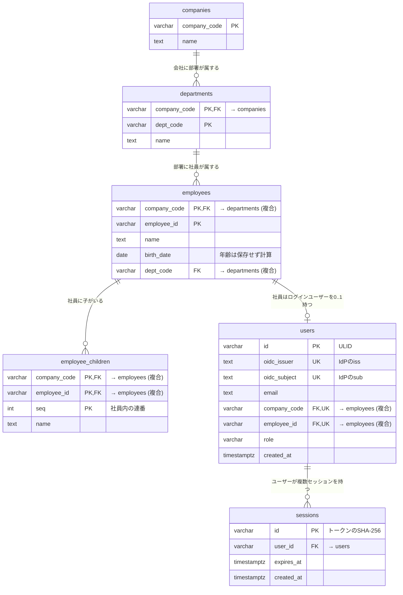

# ER図と参照整合性

実DB（`pg_constraint`）から取得した外部キーに基づく。実装は `packages/db/src/schema.ts`。

## ER図

## 親子関係と削除ルール

| 子テーブル | → 親テーブル | 外部キー | 親を削除すると |
|---|---|---|---|
| departments | companies | (company_code) | **NO ACTION**: 部署がある会社は消せない |
| employees | departments | (company_code, dept_code) | **RESTRICT**: 社員がいる部署は消せない |
| employee_children | employees | (company_code, employee_id) | **CASCADE**: 社員を消すと子も一緒に消える |
| users | employees | (company_code, employee_id) | **NO ACTION**: ユーザーが紐づく社員は消せない |
| sessions | users | (user_id) | **CASCADE**: ユーザーを消すとセッションも消える |

- 親でもあり子でもあるテーブルがある。`employees` は departments の子で、employee_children と users の親。
- ルートの親は `companies` のみ。末端の子は `employee_children` と `sessions`。
- `ON UPDATE` は未指定（NO ACTION）。参照されている主キーの値は変更できない。

## 孤児（親のいない子の行）は発生するか

DB の外部キー制約で、通常の SQL では発生しない。次の8ケースを実DBで試して確認した（ロールバック済み）。

| # | 操作 | 結果 |
|---|---|---|
| 1 | 存在しない会社の部署を INSERT | エラー（親がない） |
| 2 | 存在しない部署の社員を INSERT | エラー（親がない） |
| 3 | 社員がいる部署を DELETE | エラー（RESTRICT） |
| 4 | 子がいる社員を DELETE | 成功し、子も自動削除（CASCADE。孤児は残らない） |
| 5 | users が紐づく社員を DELETE | エラー（NO ACTION） |
| 6 | 部署がある会社を DELETE | エラー（NO ACTION） |
| 7 | ユーザーを DELETE | 成功し、sessions も自動削除（CASCADE） |
| 8 | ACME の社員に GLOBEX 専用の部署コードを使う | エラー（複合キーで会社も一致が必要） |

### 孤児が起きない仕組み
1. **INSERT 時**: 子の行は、参照先の親の行が存在しないと挿入できない（1, 2）。
2. **DELETE 時**: 親を消すとき、子がいれば拒否（RESTRICT / NO ACTION）するか、子ごと消す（CASCADE）。どちらも孤児は残らない（3〜7）。
3. **複合キー**: 自然キー（company_code を全テーブルが持つ）のため、他社の部署・社員を取り違える混入もFKで防げる（8）。サロゲートID単独の設計ではこれが防げない。

### 制約が効かない（孤児的な状態になりうる）ところ
- **IdP との対応**: `users.oidc_issuer` / `oidc_subject` は外部の Keycloak を指すが、DBの外なので外部キーにできない。Keycloak 側でユーザーを消しても `users` の行は残る（ログインはできなくなるだけ）。
- **期限切れ `sessions`**: 親（users）はいるので孤児ではないが、自動では消えない。`expires_at` にインデックスがあり、定期削除用。
- **制約の迂回**: 外部キーを無効化する操作（`session_replication_role = replica`、制約を外した後の投入など）では孤児が作れる。通常のアプリ経路や Drizzle の操作では発生しない。
- **アプリ側の絞り込み**: API は常に `company_code` で絞るが、これは孤児防止ではなく他社データの不可視化のための仕組み（DBの制約とは別物）。
